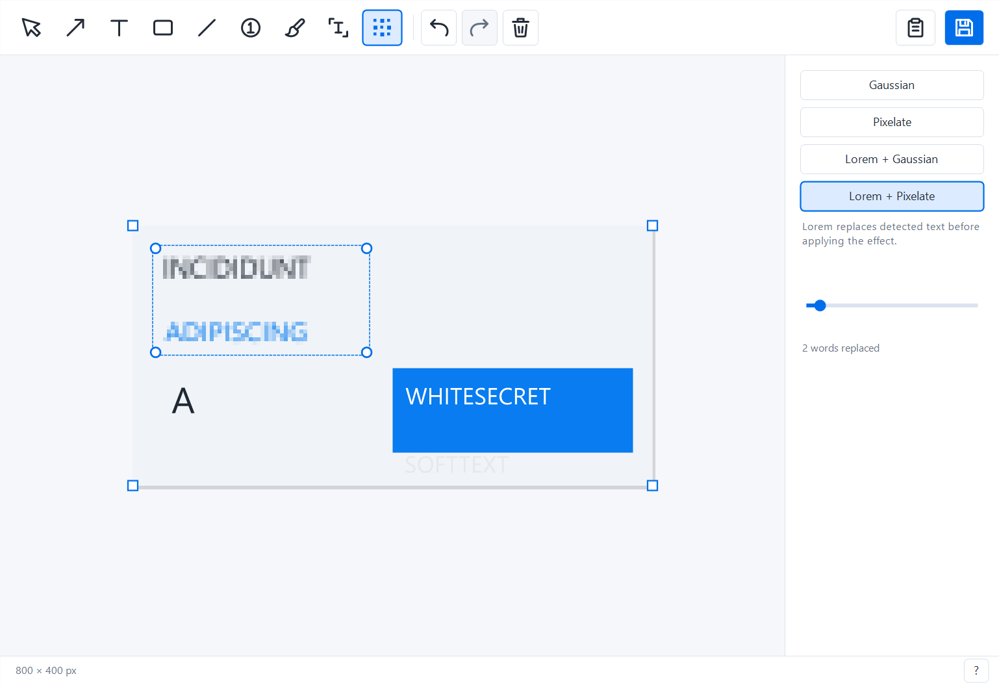
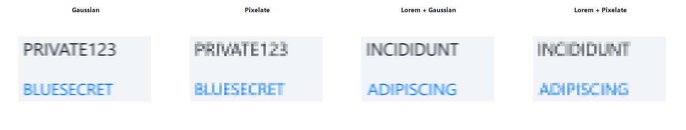

# Captura

**Capture it. Make your point. Share it.**

Captura is a tiny, portable Windows app for screenshots you can explain at a glance. Grab the part of your screen that matters, point to it with an arrow, add a few words, and paste it straight into a conversation.

> **This branch previews text selection and redaction.** Press **O** to copy recognized text, or **B** to hide a rectangular area. Choose Gaussian, Pixelate, Lorem + Gaussian, or Lorem + Pixelate. Lorem modes replace the detected text before applying the effect, using a similar size and color. Move the slider right for a stronger effect. These experiments are local and have not been published as a stable release.

Lorem text is prepared once for each capture and stays fixed while you move or resize your rectangles. Both Lorem modes share that same prepared image; only the selected area appears changed in your screenshot.

[**Download for Windows x64 →**](https://github.com/victor141516/Captura/releases/latest)

## From screen to conversation

1. **Capture.** Press **Ctrl + Shift + S** from another app, or use your chosen capture shortcut. Drag to select an area, or press **Space** to pick a window.
2. **Make it clear.** Add arrows, text, rectangles, freehand marks, or numbered steps. Every drawing tool has a keyboard shortcut. Drag the handles to get your annotations just right.
3. **Share.** Finish any text edit with **Enter**, then press **Ctrl + C** and paste the image into your chat, issue, or document. Prefer a file? **Ctrl + S** saves a PNG to **Pictures\Screenshots**.

The editor closes after a successful image copy or save. Captura stays in your system tray, ready for the next screenshot.

## Small app. Clear screenshots.

- **One small executable.** Around 400 KiB in this preview. Download `Captura.exe` and run it. No installer, account, or internet connection required. Targets 64-bit Windows 10 and 11. Text recognition needs an available Windows OCR language; this unpackaged preview has been verified on Windows 11.
- **Point precisely.** Bend arrows and lines by dragging their center diamond. Use one arrowhead or two. Number a sequence with counters; click and drag to add a pointer.
- **Write clearly.** Text appears directly on the screenshot, with a rounded background and automatic black or white contrast. Use a shared color across your tools, or choose your own fill.
- **Get the framing right.** Start with an area or a window, then drag the four corner squares to crop closer or reveal more of the surrounding desktop, captured at the same instant. Cropping stays reversible during the session.
- **Room for your point.** Draw past an edge and the canvas reveals the captured context. Beyond the full desktop, it adds a matching background. On release, unused automatic space is trimmed. Your chosen frame stays under your control.
- **Easy to revise.** Move, resize, duplicate, undo, and redo. Copy and save include only the visible frame, with no selection handles.
- **Hide just the area you choose.** Blur or pixelate a rectangle and adjust it with the same handles as your other annotations. Lorem modes substitute detected words before applying the effect; content outside the rectangle stays unchanged, even when its edge crosses a letter. Substitution depends on completed OCR and the text it detects.

## Keyboard shortcuts

| Action | Shortcut |
| --- | --- |
| New screenshot, outside the editor | **Ctrl + Shift + S** |
| Switch area / window while capturing | **Space** |
| Select and move | **V** |
| Arrow | **A** |
| Text | **T** |
| Rectangle | **R** |
| Line | **L** |
| Numbered counter | **C** |
| Freehand brush | **P** |
| Select and copy recognized text, in this preview | **O**, then drag |
| Redact an area, in this preview | **B**, then drag |
| Copy image, or selected text with Select text active | **Ctrl + C** |
| Save to Pictures\Screenshots | **Ctrl + S** |
| Choose a save location, in the editor | **Ctrl + Shift + S**, or **Shift + click Save** |
| Undo / redo | **Ctrl + Z** / **Ctrl + Y** or **Ctrl + Shift + Z** |
| Delete / duplicate an annotation | **Del** / **Ctrl + D** |
| Next / previous annotation | **Tab** / **Shift + Tab** |
| Move selected annotation | **Arrow keys**; hold **Shift** for 10-pixel steps |
| Tool size | **+** / **−** |
| Confirm text / add a line | **Enter** / **Shift + Enter** |
| Zoom | **Ctrl + mouse wheel** |
| Fit image / actual size | **Ctrl + 0** / **Ctrl + 1** |
| Pan | **Middle mouse drag**, or **Space + drag** |
| Scroll vertically / horizontally | **Mouse wheel** / **Shift + mouse wheel** |
| Cancel capture, text edit, or a drag | **Esc** |
| Help | **F1** |

Hold **Shift** while drawing to make square rectangles or align a line or arrow at 45-degree angles. Right-click the **Background** swatch to turn a fill on or off. Hover over toolbar icons to see their names and shortcuts.

Scroll and pan to explore your screenshot. Movement stops at its edges, so the image stays within reach even when you change the zoom or resize the editor.

Windows recognizes text in the background when each capture opens, including context outside your initial crop. Select text highlights recognized words; dragging an area or clicking a word copies its text. The editor stays open after text copy, and its panel shows elapsed time, process CPU, and sampled RAM. Words covered by redaction rectangles are excluded from original-text copying.

Prefer a different capture shortcut? Right-click Captura's tray icon and choose **Capture shortcut…**. Click the field, press your combination, and choose **Save**. Unavailable shortcuts show an inline error and leave your previous shortcut intact. **Reset to default** restores Ctrl + Shift + S when saved. Your preference is remembered between sessions; Help and the tray menu show the current combination. **Ctrl + Shift + S inside the editor** still opens Save As.

## Ready when you need it

Closing the editor keeps Captura in the tray. Click its icon to reopen the current screenshot, double-click to take another, or use the tray menu to exit. Starting a new screenshot replaces the current one.

To update, save anything you want to keep, choose **Exit** from the old version's tray menu, and run the new `Captura.exe`.

---

Want to build or contribute? See the [development guide](docs/development.md).
