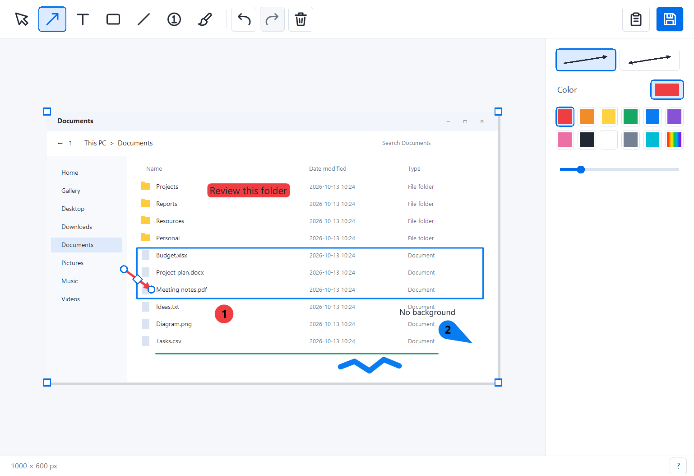

# Captura

**Capture it. Make your point. Share it.**

Captura is a tiny, portable Windows app for screenshots you can explain at a glance. Grab the part of your screen that matters, point to it with an arrow, add a few words, and paste it straight into a conversation.

[**Download for Windows x64 →**](https://github.com/victor141516/Captura/releases/latest)

## From screen to conversation

1. **Capture.** Press **Ctrl + Shift + S** from another app. Drag to select an area, or press **Space** to pick a window.
2. **Make it clear.** Add arrows, text, rectangles, freehand marks, or numbered steps. Every drawing tool has a keyboard shortcut. Drag the handles to get your annotations just right.
3. **Share.** Finish any text edit with **Enter**, then press **Ctrl + C** and paste the image into your chat, issue, or document. Prefer a file? **Ctrl + S** saves a PNG to **Pictures\Screenshots**.

The editor closes after a successful copy or save. Captura stays in your system tray, ready for the next screenshot.

## Small app. Clear screenshots.

- **One small executable.** Around 284 KiB. Download `Captura.exe` and run it. No installer, account, or internet connection required. Works on 64-bit Windows 10 and 11.
- **Point precisely.** Bend arrows and lines by dragging their center diamond. Use one arrowhead or two. Number a sequence with counters; click and drag to add a pointer.
- **Write clearly.** Text appears directly on the screenshot, with a rounded background and automatic black or white contrast. Use a shared color across your tools, or choose your own fill.
- **Get the framing right.** Drag the four canvas corner squares to crop. Change your mind? Stretch back to reveal the original screenshot and annotations during the same session. Go further to add space around the image.
- **Room for your point.** Draw past an edge and the canvas grows with you. On release, unused automatic space is trimmed. Your chosen manual crop stays under your control.
- **Easy to revise.** Move, resize, duplicate, undo, and redo. Copy and save include only the visible frame, with no selection handles.

## Keyboard shortcuts

| Action | Shortcut |
| --- | --- |
| New screenshot, outside the editor | **Ctrl + Shift + S** |
| Switch area / window while capturing | **Space** |
| Select and move | **V** |
| Arrow | **A** |
| Text | **T** |
| Rectangle | **R** |
| Line | **L** |
| Numbered counter | **C** |
| Freehand brush | **P** |
| Copy image | **Ctrl + C** |
| Save to Pictures\Screenshots | **Ctrl + S** |
| Choose a save location, in the editor | **Ctrl + Shift + S**, or **Shift + click Save** |
| Undo / redo | **Ctrl + Z** / **Ctrl + Y** or **Ctrl + Shift + Z** |
| Delete / duplicate an annotation | **Del** / **Ctrl + D** |
| Next / previous annotation | **Tab** / **Shift + Tab** |
| Move selected annotation | **Arrow keys**; hold **Shift** for 10-pixel steps |
| Tool size | **+** / **−** |
| Confirm text / add a line | **Enter** / **Shift + Enter** |
| Zoom | **Ctrl + mouse wheel** |
| Fit image / actual size | **Ctrl + 0** / **Ctrl + 1** |
| Pan | **Middle mouse drag**, or **Space + drag** |
| Scroll vertically / horizontally | **Mouse wheel** / **Shift + mouse wheel** |
| Cancel capture, text edit, or a drag | **Esc** |
| Help | **F1** |

Hold **Shift** while drawing to make square rectangles or align a line or arrow at 45-degree angles. Right-click the **Background** swatch to turn a fill on or off. Hover over toolbar icons to see their names and shortcuts.

## Ready when you need it

Closing the editor keeps Captura in the tray. Click its icon to reopen the current screenshot, double-click to take another, or use the tray menu to exit. Starting a new screenshot replaces the current one.

To update, save anything you want to keep, choose **Exit** from the old version's tray menu, and run the new `Captura.exe`.

---

Want to build or contribute? See the [development guide](docs/development.md).
