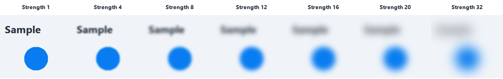
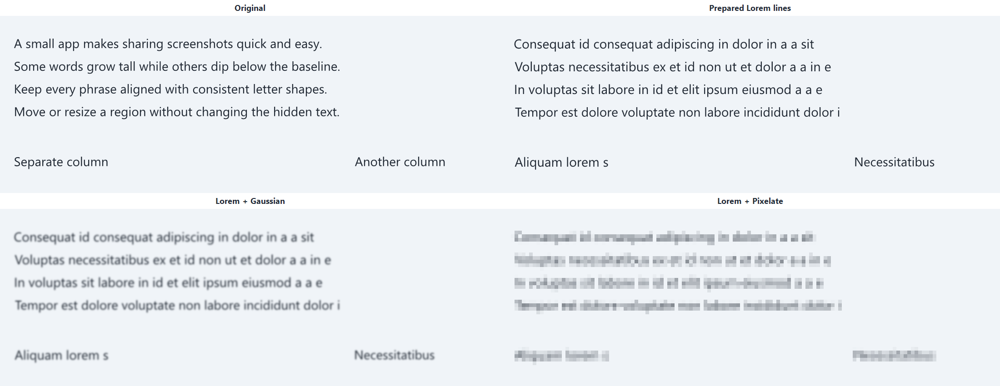
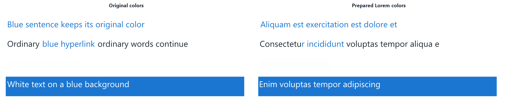

# Development

Captura targets Windows 10 / 11 x64 and uses C++20, Win32, and GDI+. The C++ runtime is linked statically. Running the app requires only Windows components.

## Build

Install Visual Studio 2022 Build Tools with **Desktop development with C++** and a Windows SDK. PowerShell 5.1 or later is sufficient; no developer shell is needed.

From the repository root:

```powershell
.\build.ps1
```

The portable executable is written to `dist\Captura.exe`. Choose a different destination with `-OutputDirectory`.

## Verify

```powershell
.\test.ps1
```

The integration suite creates hidden native windows and synthetic screenshots. It covers capture selection, annotation geometry, undo/redo, inline text, color and contrast, reversible crop and expansion, PNG/DIB exports, resource lifetime, and pixel comparisons between cached and complete rendering.

Tests write to `build\test-results`. They do not capture personal content, change the real clipboard, or save files in the user's Pictures folder. The normal executable excludes the test suite.

For an interactive preview of the shortcut dialog, run the test executable with `--shortcut-preview` followed by an absolute directory for isolated preferences. This mode creates no tray icon, global shortcut, keyboard hook, or singleton; it can run beside the real app without affecting the current screenshot.

## Layout

- `src/main.cpp`: application model, geometry, rendering, input, export, and window lifetime.
- `src/ui_text.h`: English interface text and help.
- `src/capture_shortcut.h`: shortcut validation, display, atomic preference storage, and registration replacement.
- `src/ocr.h`, `src/ocr.cpp`: cancellable background Windows OCR and measurement, with immutable bitmap snapshots and plain text/geometry results.
- `src/redaction.h`, `src/redaction.cpp`: regional Gaussian blur, area-averaged pixelation, and color/font-size estimation for Lorem substitution.
- `src/qr.h`, `src/qr.cpp`: synchronous regional QR decoding over the original bitmap, link detection, and quadrilateral hit testing on top of the vendored decoder.
- `src/hdr.h`, `src/hdr.cpp`: FP16 desktop duplication of HDR monitors and per-window conversion to SDR (BT.2390, hue-preserving).
- `src/quirc/`: unmodified [quirc](https://github.com/dlbeer/quirc) 1.0 sources (ISC license, see `src/quirc/LICENSE`). `build.ps1` compiles them as C at `/W3` and links the objects into the single executable.
- `src/resource.h`: native dialog control identifiers.
- `src/app.rc`, `src/app.manifest`: version and Windows application resources.
- `tests/integration.inc`: native integration suite included only in test builds.
- `tests/shortcut.inc`: shortcut persistence, failure handling, and dialog tests with fake registrations and isolated settings.
- `tests/retained_desktop.inc`: selected frame, retained desktop, context expansion, undo/redo, and visible export tests.
- `tests/navigation.inc`: middle-button and wheel input, navigation caches, quality restoration, clipping, bounded zoom memory, and GDI resource tests. Writes `navigation-performance.txt` with timings for a retained 4K desktop and selected frame.
- `tests/navigation_bounds.inc`: actual scroll and drag boundary behavior for smaller, larger, cropped, and expanded frames, including reversal, zoom, and window resize.
- `tests/ocr.inc`: text geometry, Unicode clipboard hooks, cancellation, retained-desktop selection, and real Windows OCR on synthetic screenshots. Writes `ocr-editor.png` and `ocr-benchmark.txt`.
- `tests/redaction.inc`: exact clipping, partial glyphs, color estimates, opacity, pixel averages, editing/history, dependent annotations, protected OCR copying, real OCR on substituted pixels, preview/export quality, and shutdown. Writes redaction previews and `redaction-performance.txt`.
- `tests/qr.inc`: link detection rules, drag and click scanning on synthetic QR pixels, copy and Ctrl + click hooks, hit testing, cancellation, zoom, and export isolation. Writes `qr-editor.png`.
- `tests/hdr.inc`: FP16 decoding, the tone curve, exact SDR reproduction, region bounds, hue and gamut handling, display-peak capping, and percentile peaks on synthetic scRGB buffers.
- `docs/assets`: synthetic screenshots used in the product README.
- `build.ps1`, `test.ps1`: build and verification entry points.

Format C++ changes with clang-format 19 and the checked-in `.clang-format`. Include order is preserved because Windows SDK headers depend on it.

## Release

Update the version in `app.rc` and `app.manifest`, run the tests and `tests/startup.ps1`, then build with `release.ps1`. The release script packages the normal executable at the ZIP root and generates the WinKit manifest and SHA-256 checksums. Release binaries remain portable and never include test code or build outputs. See [WinKit integration](winkit.md) for the startup and publication contract.

The app keeps editable content in memory during its session. A saved PNG contains the final visible frame, not an editable project.

## OCR preview

Captura scans the original retained desktop, without annotations, once when `finishCapture` loads an image. The initial frame does not limit recognition. A dedicated MTA worker owns a private bitmap clone, so it never locks the bitmap used by the UI renderer. A newer capture cancels the previous job and replaces pending work; result IDs prevent stale completion messages from updating a newer capture. Shutdown joins the worker before GDI+ is released.

Windows OCR receives native-resolution blocks up to 2600 pixels per side, or the smaller system limit, with 128 pixels of context around seams. Words belong to the tile core containing their center. Row fragments are merged geometrically. This preview uses rectangular word bounds and top-to-bottom / left-to-right ordering; complex columns, rotated text, and scripts requiring other reading orders need further evaluation.

Select text draws overlays only in the current visible frame. Selection uses word centers to avoid copying neighbors when a rectangle barely touches them. OCR overlays are never exported. Text copy uses `CF_UNICODETEXT` and keeps the editor open so the experiment supports repeated selections; normal image exports retain their existing behavior.

Wall time uses QueryPerformanceCounter and includes snapshot preparation and any worker queue delay. Recognition time sums the async API waits. Lorem preparation is timed separately and included in total elapsed and process CPU measurements. GetProcessTimes measures CPU for the **whole process**, not an isolated OCR thread; divide CPU time by elapsed time and logical processor count for average Task Manager-style CPU percentage. Working set is sampled during recognition, including the pre-job baseline; reported growth is relative to that baseline. These are diagnostic process metrics and can include concurrent rendering or previous recognition. CPU counters have finite granularity and RAM samples can miss short peaks. Screenshots, recognized text, and metrics are not automatically persisted or sent anywhere.

No OCR model is bundled or installed. The engine uses the user's Windows OCR languages and falls back to the first available language. Missing languages or API failures produce an inline unavailable/error state. The standalone unpackaged probe and integration tests work on the local Windows 11 host with `en-US`; this does not establish compatibility with every supported Windows build. See `examples/windows-ocr` for the minimal probe.

## HDR capture

With HDR enabled, Windows composes the desktop in FP16 scRGB, where 1.0 is 80 nits. GDI screen capture encodes that composition with 1.0 as white. SDR windows come out right because Windows hands GDI their native pixels, but HDR content (games, HDR video) clips per channel above 80 nits: highlights burn and bright colors shift toward yellow and white. The Windows screenshot tools show the same artifact.

`captureDesktop` keeps the GDI capture and then calls `convertHdrDesktop`. Each output whose color space is `DXGI_COLOR_SPACE_RGB_FULL_G2084_NONE_P2020` is recaptured with `IDXGIOutput5::DuplicateOutput1` in `R16G16B16A16_FLOAT` and normalized by that monitor's SDR white level (`DISPLAYCONFIG_SDR_WHITE_LEVEL`), so the "SDR content brightness" setting is honored. SDR monitors, rotated HDR monitors, and any duplication failure keep the GDI pixels.

A single global curve cannot keep both SDR windows at white and HDR highlights distinguishable, so conversion runs per visible top-level window region (front to back, plus the remaining desktop; click-through overlays are skipped). A region's peak is the 99.9th percentile of max RGB, capped at the display's `MaxLuminance`. If that peak is at or below SDR white, the region is encoded linearly; opaque SDR windows then reproduce the GDI bytes exactly. Brighter regions get the BT.2390 EETF in PQ space from their peak to SDR white: tones below the knee stay unchanged and highlights roll off. The curve scales all three channels by one max-RGB gain, so hue is preserved; negative (wide-gamut) components are desaturated toward luminance instead of clipped. Translucent windows over HDR content also use the duplicated composition, which matches the screen better than GDI's blend over clipped pixels.

The first duplicated frame can be empty, and DWM produces a frame only when something changes. If no image arrives within 100 ms, an almost transparent 1-pixel layered window at the monitor corner forces one composition. The Direct3D device is cached for the session because creating it (loading the driver) costs about 130 ms. On a 4K HDR monitor, later captures add about 65 ms; per-pixel work is split across up to eight threads. `tests/hdr.inc` covers the conversion on synthetic FP16 buffers. Duplication itself needs HDR hardware and was verified manually.

## QR scan

Scan QR reads the original retained desktop bitmap, without annotations, for the dragged rectangle (clipped to the bitmap) or, on a plain click, for the current visible frame. Decoding runs synchronously on the UI thread: the region is converted to 8-bit luma, padded with a white quiet zone, and upscaled by nearest neighbor until its longer side reaches 400 pixels so small on-screen codes keep several pixels per module. Mirrored codes are retried after `quirc_flip`. Payloads honor the ECI code page when present; otherwise valid UTF-8 is preferred and Latin-1 is the fallback, matching common generators and the standard default.

Results live in `AppState` as image-space quadrilaterals, never as annotations, so they do not touch undo history or exports. Only `http://`, `https://`, and bare `www.` payloads count as links; Ctrl + click opens those with `ShellExecuteW` and copies everything else, so a decoded `file:` or custom scheme can never launch a handler. Tests replace the clipboard and shell with `testCopiedText` and `testOpenedUrl` hooks and drive Ctrl through `testCtrlPressed`.

## Redaction preview

Redaction rectangles are editable items with immutable, shared raster caches. Cache keys cover region, strength, mode, source, completed OCR, background fill, preview quality, and the content of preceding annotations. History can share caches safely because changed parameters create a new cache. Preview painting uses bounded rasters during gestures; image copy and PNG export always request full-resolution pixels, including during a gesture. Shutdown releases caches in items, history, and gesture snapshots before GDI+ stops.

Gaussian uses a separable, normalized Gaussian kernel with `sigma = 0.45 * strength`, truncated at three standard deviations. Both axes use identical weights, clamped edge samples, floating-point intermediate channels, and one final rounding step. SSE2 processes the four channels together and is part of the Windows x64 baseline. This replaces GDI+ Blur, which reproduced a horizontal-only response at low radii on the test host. There is no algorithm switch within the slider range. Preview sigma scales with preview resolution. Pixelation averages each selected-region block, then writes that color uniformly; rendering uses nearest-neighbor upsampling. Both strengths are in original-image pixels. Patches are opaque and drawn with source-copy compositing so original text cannot show through a blurred edge. The source screenshot remains unchanged; only the processed patch is composed into exports.

`tests/gaussian.inc` checks all 64 slider strengths against an independent two-dimensional Gaussian reference, horizontal/vertical symmetry, monotonic spread, gradual transitions, and identical filtering in both Gaussian modes. It also covers bounded previews, uniform colors, and one-pixel dimensions. The suite writes spread measurements and a synthetic strength comparison:



Immediately after OCR, the MTA worker consumes its existing private screenshot clone to prepare one full-desktop Lorem image, then publishes it together with the OCR report using release/acquire synchronization. It joins words into rows using vertical overlap and center proximity, sorts each row left-to-right, and splits gaps greater than 1.5 times the neighboring ink height. This joins OCR fragments without bridging separate columns. Each contiguous run receives one replacement phrase and one glyph path, sharing a baseline, height, and horizontal scale; individual words are never transformed separately.

Background is estimated from a 4-pixel ring around each run. Foreground is sampled per source word, grouped into RGB buckets using a relative contrast threshold, then taken from the strongest glyph-core sample within the winning bucket. This avoids antialiased edges washing out colors and keeps faint colors instead of inventing black or white. Similar foreground colors are merged into contiguous spans. All spans paint the same transformed line path, clipped near the source color positions; transitions favor nearby gaps between glyph contours to avoid splitting a glyph's color. All color estimates precede all erasures and replacement drawing, so sampling never sees generated text.

Cancellation discards the partially prepared snapshot. Completed images are immutable until the next capture. Lorem substitutions use a stable per-capture seed and preserve the source run's character count (up to 512 characters) and capitalization while always changing its content. Preparation tries up to six replacement phrases and chooses the best natural fit, stopping early at 97% box coverage. Every candidate uses one uniform scale for both axes and is centered vertically within the original run. This preserves ordinary typeface proportions instead of squeezing or stretching glyphs to force an exact OCR rectangle. The text may leave a small margin within that rectangle. This approximates font size/color; font family and weight, complex backgrounds, and missed or inaccurate OCR boxes remain heuristic limits. Undetected text receives the chosen blur or pixelation without substitution. This feature is not a guarantee of irreversible removal of every sensitive pattern.

`tests/lorem_lines.inc` checks that separately reported words with different ink heights produce exactly the same replacement as a complete-line OCR box, including shuffled fragment order and separate columns. It also runs real Windows OCR on a multiline fixture and renders both Lorem effects:



`tests/lorem_colors.inc` checks blue lines, inline blue links amid dark text, very faint blue, white on blue, both filters, immutable images, and real Windows OCR on colored lettering:



`tests/lorem_typography.inc` checks deliberately wide and tall OCR rectangles against reference glyphs drawn directly at ordinary font sizes. The reference uses translation only after choosing a font size, so independent horizontal/vertical stretching cannot pass.

Ordinary modes read the original image; Lorem modes sample the prepared image and apply only the selected regional effect. No text generation or color estimation occurs while editing rectangles. Partial glyph selections simply crop fixed prepared pixels, and only the chosen rectangle is composed into the original screenshot. Earlier annotations still participate in effects; earlier redaction items are skipped when composing a new Lorem patch so they cannot reintroduce original screenshot text. The worker snapshot is reused rather than creating another full-size copy, at the cost of retaining one full-desktop bitmap for the session. Original words intersecting any redaction are excluded from OCR highlights and original-text copying. Lorem controls require completed OCR; if a Lorem effect cannot be prepared, an opaque cover is exported instead of silently revealing or merely blurring the original.

Area and window selection transfer the complete frozen desktop bitmap into the editor without cloning or cropping it. The initial selection is stored as the canvas frame and trim baseline in desktop-bitmap coordinates. The renderer clips to that frame, and expansion reveals pixels already in the source. Synthetic fill is used only outside the complete bitmap. PNG and clipboard export translate and clip the source and annotations to the current visible frame.

During panning, scaled image pixels are translated independently of the camera's integer origin. A fractional-origin or scale change rebuilds the raster; large zoom levels use a bounded viewport tile with overscan. Navigation also retains static toolbar pixels. Wheel zoom stretches a native top-down RGB copy of the immutable source, then a 140 ms idle timer restores the final-quality view. These display caches never affect PNG or clipboard export. Filtered PARGB cache rendering and direct HDC rendering can differ by up to two RGB levels due to rounding; navigation comparisons permit that only inside the visible image, with exact toolbar and framing pixels.

The capture shortcut is stored per user at `%LOCALAPPDATA%\Captura\settings.ini`, so it survives replacing the portable executable. Tests never access that file, register a real global shortcut, or install the keyboard recorder. The recorder is active only while the real shortcut dialog is open and intercepts combinations only while its input field is focused.
